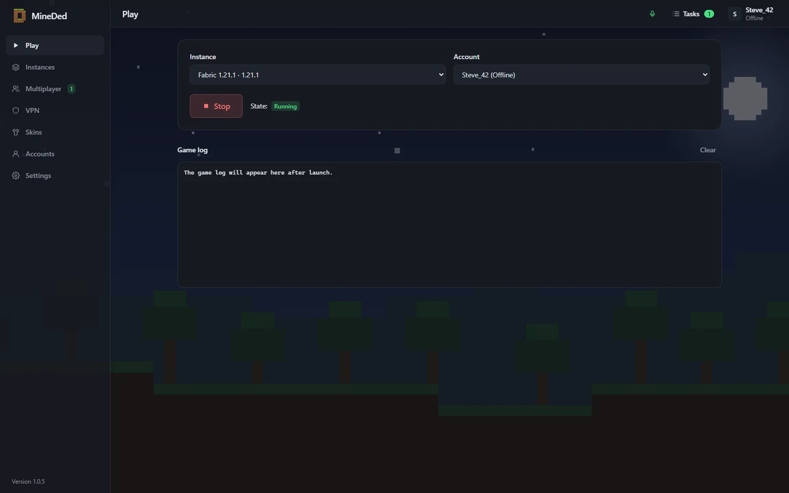
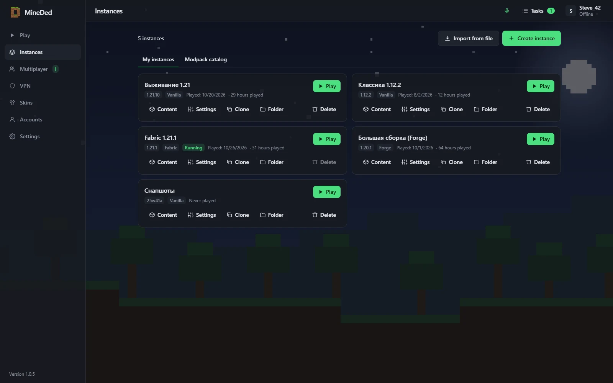
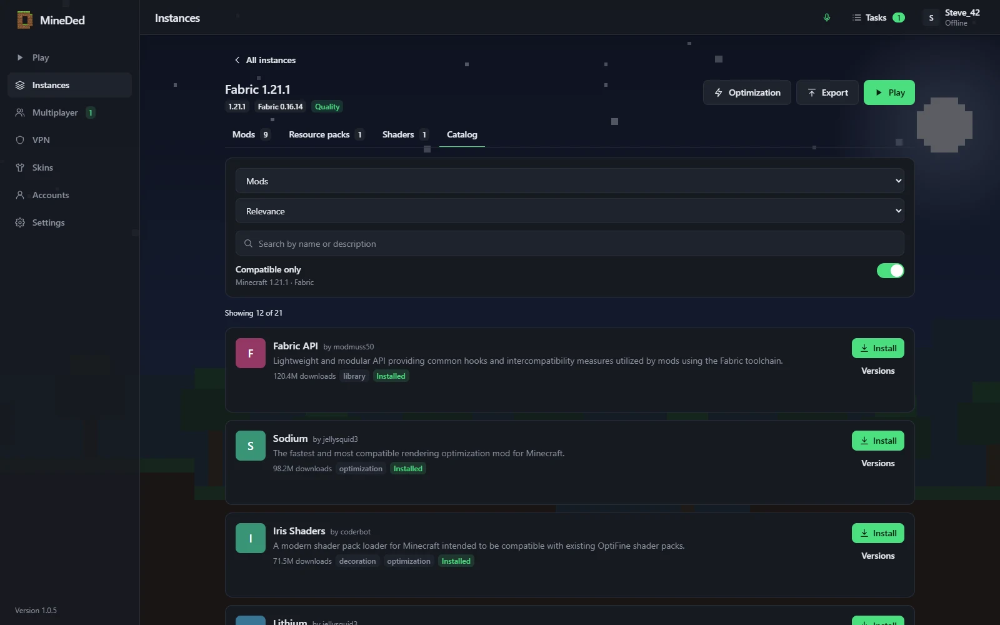
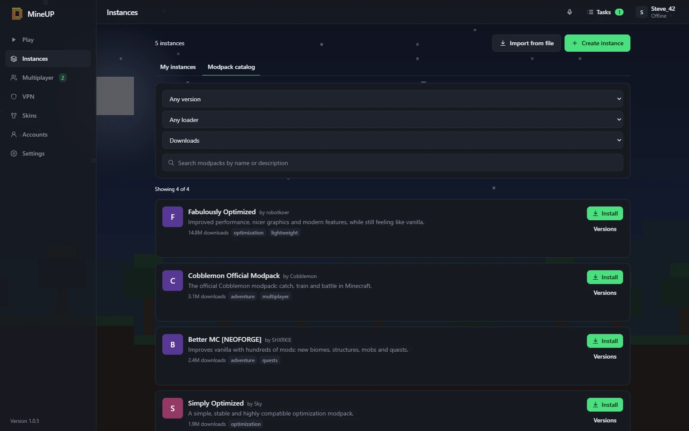
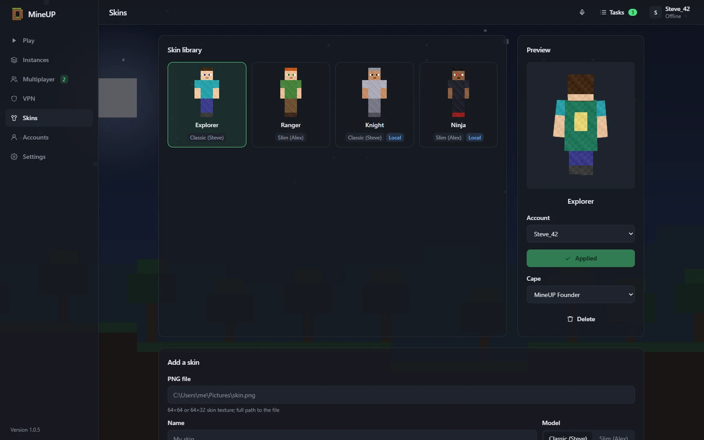
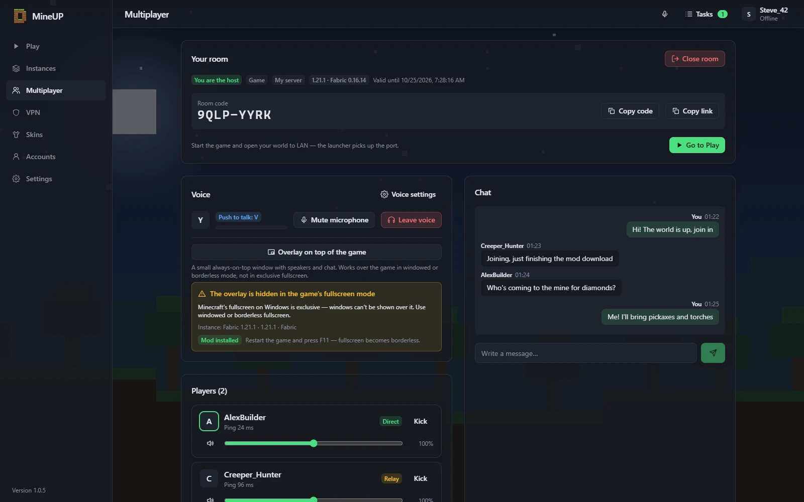
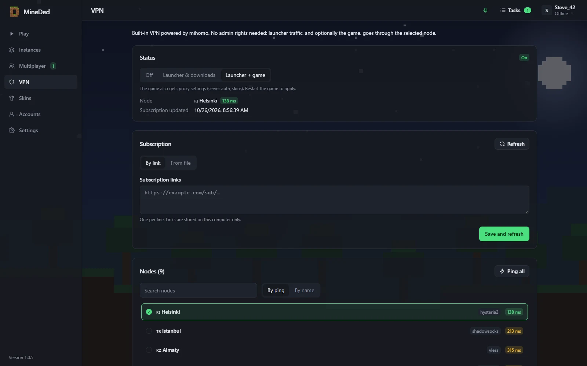

<div align="center">

[Русский](README.md) · **English**


# MineDed

**A free Minecraft launcher for playing with friends — no server rental needed.**

[](https://github.com/Dedseckms/MineDed/releases/latest)
[](https://github.com/Dedseckms/MineDed/releases)
[](#install)
[](LICENSE)

### [⬇ Download](https://github.com/Dedseckms/MineDed/releases/latest) · [🌐 Website](https://mineded.dedseckms.ru/) · [🚀 Quick start](#quick-start)



</div>

## Features

| | |
|---|---|
| 🎮 **Every version and loader** | Vanilla, Fabric, Quilt, Forge, NeoForge — one click to install, Java is picked automatically |
| 🧩 **Mods and modpacks** | Modrinth catalog: mods, shaders, resource packs and modpacks with dependencies and updates; your own mods from disk with a dependency check |
| 👕 **Own skins** | Own skin and cape server with a 3D preview — friends see your skin in game |
| 🌍 **Multiplayer without a server** | Create a room and send the code — your friend gets your modpack automatically and joins. End-to-end encrypted P2P with a relay fallback, no port forwarding |
| 🎙 **Voice and chat** | Built-in voice and text chat with noise suppression, push-to-talk and an in-game overlay |
| 🛡 **Works behind blocks** | Built-in VPN (VLESS / mihomo), mirrors and smart routing |
| 🥔 **Low-end PCs** | Optimization presets: mods, memory, JVM flags and graphics settings |
| 🔄 **Auto-updates** | Signed updates from GitHub or a mirror |

## Screenshots

| | |
|---|---|
|  |  |
|  |  |
|  |  |

## Install

Download an installer from [Releases](https://github.com/Dedseckms/MineDed/releases/latest):

| OS | File |
|---|---|
| Windows 10/11 | `MineDed_x.y.z_x64-setup.exe` (or `.msi`) |
| Linux | `MineDed_x.y.z_amd64.AppImage` (make it executable) or `.deb` |

The launcher updates itself; updates are signed. The interface is available in Russian and English.

## Quick start

1. **Accounts** → add an offline account (just a nickname) or "My server" — sign in / register with an invite on the skin server, with skins and capes.
2. **Instances** → "Create": game version and loader (Vanilla / Fabric / Quilt / Forge / NeoForge). Java is installed automatically.
3. Inside an instance — mods, resource packs and shaders tabs: Modrinth search, automatic dependencies, one-click update and disable. Modpacks are in the "Modpack catalog" tab; `.mrpack` import / export.
4. **Play**. For low-end PCs use the optimization presets and automatic memory in the instance settings.

## Multiplayer without a server

- Host: **Multiplayer → Open world to friends** (optionally with a password) — the code appears at once; send it or the link `mineded://join/CODE`. Then in game: Esc → "Open to LAN".
- Guest: **Multiplayer → Join**, enter the code (or click the link). If you don't have the host's modpack, press "Download and play" — it is installed automatically. The `127.0.0.1:port` server appears in the game's server list.
- The connection is encrypted, direct or via a relay when a direct link is impossible.
- If the host signed in with "My server", guests must use that server too; an offline host accepts everyone.

## Voice and chat

Every room has text and voice chat. To play on a regular server, create a **Voice room** (no instance). Settings → "Voice chat": push-to-talk with a key of your choice or voice activation, microphone, per-player volume. The compact in-game overlay works in windowed / borderless mode (not exclusive fullscreen; on Wayland it may not stay on top).

## If something is blocked

- The launcher tries mirrors and proxies on its own: built-in VPN → manual proxy → system proxy.
- **VPN**: paste a subscription link (VLESS / mihomo) or a file and pick a node. Modes: "Launcher and downloads", "Launcher + game" or "Selected programs". No admin rights needed except for "Selected programs"; no conflict with an installed Clash/mihomo.
- Manual proxy (HTTP / SOCKS5) — in Settings.

## Building from source

You need Rust (stable), Node 20+ and pnpm; on Linux also `libwebkit2gtk-4.1-dev libayatana-appindicator3-dev librsvg2-dev libasound2-dev libx11-dev libxdo-dev pkg-config`. See [CONTRIBUTING.md](CONTRIBUTING.md).

```sh
pnpm install
pnpm --filter desktop build
cargo test --workspace
pnpm tauri build
```

## License

GPL-3.0-or-later, see [LICENSE](LICENSE). Not an official Minecraft product. Not affiliated with Mojang or Microsoft.
