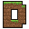
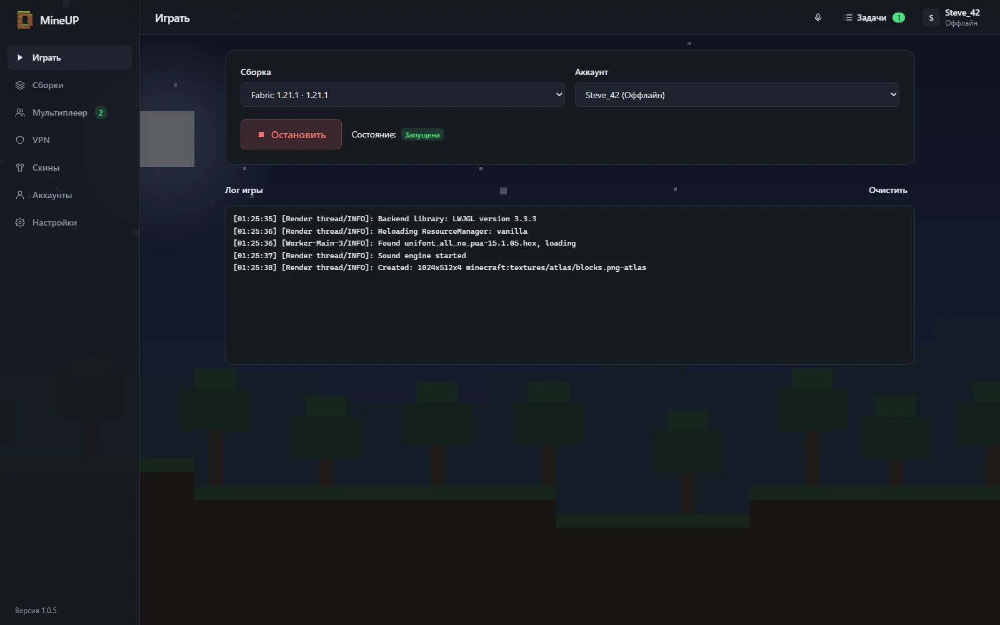
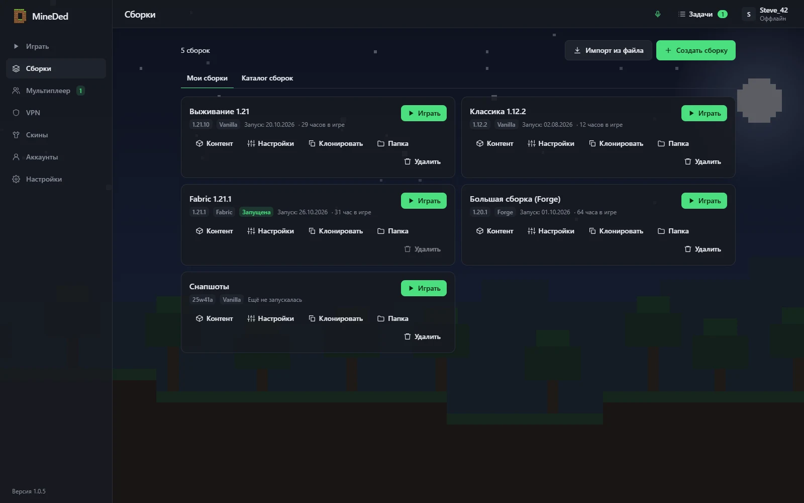
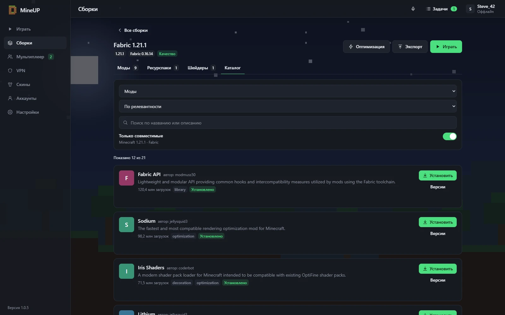
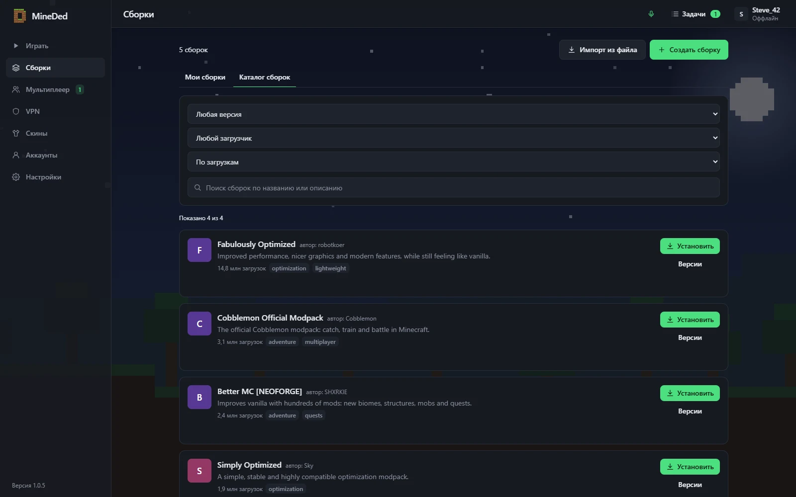
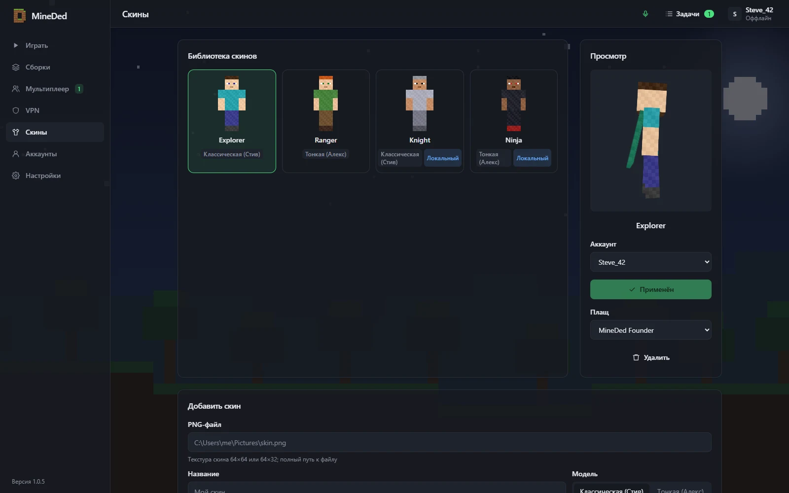
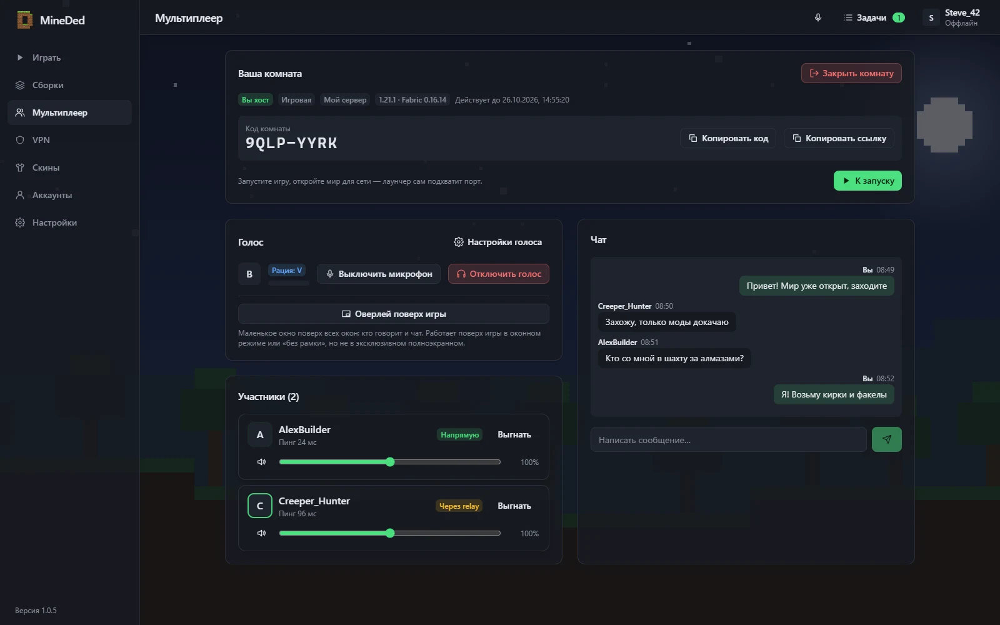
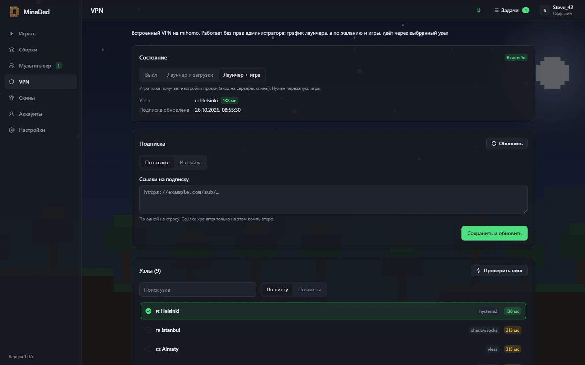

<div align="center">



# MineDed

**Бесплатный лаунчер Minecraft для игры с друзьями — без аренды сервера.**

*Free open-source Minecraft launcher: mods, skins, server-free multiplayer and voice chat.*

[](https://github.com/Dedseckms/MineDed/releases/latest)
[](https://github.com/Dedseckms/MineDed/releases)
[](#установка)
[](LICENSE)

### [⬇ Скачать](https://github.com/Dedseckms/MineDed/releases/latest) · [🌐 Сайт](https://mineded.dedseckms.ru/) · [🚀 Быстрый старт](#быстрый-старт)



</div>

## Возможности

| | |
|---|---|
| 🎮 **Все версии и загрузчики** | Vanilla, Fabric, Quilt, Forge, NeoForge — ставятся в один клик, Java подбирается сама |
| 🧩 **Моды и сборки** | Каталог Modrinth: моды, шейдеры, ресурспаки и готовые сборки с зависимостями и обновлениями |
| 👕 **Свои скины** | Собственный сервер скинов и плащей с 3D-превью — друзья видят ваш скин в игре |
| 🌍 **Мультиплеер без сервера** | Открой мир друзьям по коду комнаты: P2P-шифрование, relay на запас, без проброса портов |
| 🎙 **Голос и чат** | Встроенный голосовой и текстовый чат, push-to-talk, окно поверх игры |
| 🛡 **Работает при блокировках** | Встроенный VPN (VLESS / mihomo), зеркала и умная маршрутизация |
| 🥔 **Слабые ПК** | Пресеты оптимизации: моды, память, флаги JVM и настройки графики |
| 🔄 **Автообновления** | Подписанные обновления с GitHub или зеркала |

## Скриншоты

| | |
|---|---|
|  |  |
|  |  |
|  |  |
## Установка

Скачайте установщик из [Releases](https://github.com/Dedseckms/MineDed/releases/latest):

| ОС | Файл |
|---|---|
| Windows 10/11 | `MineDed_x.y.z_x64-setup.exe` (или `.msi`) |
| Linux | `MineDed_x.y.z_amd64.AppImage` (сделайте исполняемым) или `.deb` |

Лаунчер обновляется сам; обновления подписаны.

## Быстрый старт

1. **Аккаунты** → добавьте оффлайн-аккаунт (просто ник) или «Мой сервер» — вход/регистрация по инвайту на сервере скинов, со скинами и плащами.
2. **Сборки** → «Создать»: версия игры, загрузчик (Vanilla / Fabric / Quilt / Forge / NeoForge). Java ставится автоматически.
3. Внутри сборки — вкладки модов, ресурспаков и шейдеров: поиск по Modrinth, зависимости ставятся сами, обновление и отключение в один клик. Готовые сборки — во вкладке «Каталог сборок»; импорт / экспорт `.mrpack`.
4. **Играть**. Для слабых ПК — пресеты оптимизации и автоподбор памяти в настройках сборки.

## Мультиплеер без сервера

- Хост: запустите мир, нажмите в игре «Открыть для сети», затем в лаунчере **Мультиплеер → Открыть мир друзьям** (можно с паролем). Отправьте друзьям код или ссылку `mineup://join/КОД`.
- Гость: **Мультиплеер → Войти**, введите код. Лаунчер покажет локальный адрес `127.0.0.1:порт` — добавьте его в игре как сервер.
- Соединение шифрованное, напрямую или через relay, если прямое невозможно.
- Если хост вошёл через «Мой сервер», гости тоже должны быть с этого сервера; оффлайн-хост принимает всех.

## Голос и чат

В каждой комнате есть текстовый и голосовой чат. Для игры на обычном сервере создайте **Голосовую комнату** (без сборки). Настройки → «Голосовой чат»: push-to-talk с выбором клавиши или активация голосом, микрофон, громкость каждого участника. Компактное окно поверх игры работает в оконном / borderless-режиме (не в эксклюзивном полноэкранном; на Wayland может не держаться поверх).

## Если что-то заблокировано

- Лаунчер сам пробует зеркала и прокси: встроенный VPN → ручной прокси → системный прокси.
- **VPN**: вставьте ссылку подписки (VLESS / mihomo) или файл, выберите узел. Режимы: «Лаунчер и загрузки» или «Лаунчер + игра». Права администратора не нужны, с уже установленным Clash/mihomo не конфликтует.
- Ручной прокси (HTTP / SOCKS5) — в Настройках.

## Сборка из исходников

Нужны Rust (stable), Node 20+ и pnpm, на Linux — `libwebkit2gtk-4.1-dev libayatana-appindicator3-dev librsvg2-dev libasound2-dev libx11-dev libxdo-dev pkg-config`.

```sh
pnpm install
pnpm --filter desktop build
cargo test --workspace
pnpm tauri build
```

## Лицензия

GPL-3.0-or-later, см. [LICENSE](LICENSE).
